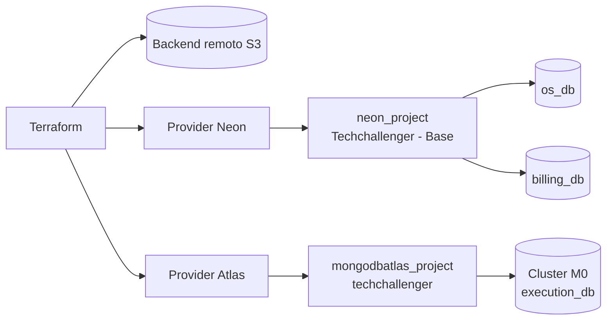

# TechChallengerFiap-DB

## Propósito

Este repositório provisiona, via Terraform, os bancos de dados dos microsserviços do TechChallengerFiap. Cada serviço tem o próprio banco e as próprias credenciais, e nenhum serviço acessa o banco de outro.

| Serviço | Banco | Tipo |
|---|---|---|
| OS Service | Neon, database `os_db` (role `os_service`) | SQL (PostgreSQL) |
| Billing Service | Neon, database `billing_db` (role `billing_service`) | SQL (PostgreSQL) |
| Execution Service | MongoDB Atlas M0, database `execution_db` (user `execution_service`) | NoSQL (documentos) |

## Tecnologias utilizadas

- Terraform
- Provider Neon (`kislerdm/neon`)
- Provider MongoDB Atlas (`mongodb/mongodbatlas`)
- AWS S3 para armazenamento do state do Terraform

## Arquitetura específica do repositório



## Passos para execução e deploy

### Pré-requisitos

- Terraform 1.6 ou superior
- Conta Neon e API key
- Conta MongoDB Atlas, com o ID da organização e uma API key de organização (papel *Organization Project Creator*)
- Credenciais AWS para o backend S3

### Secrets do GitHub Actions

| Secret | Uso |
|---|---|
| `NEON_API_KEY`, `NEON_ORG_ID` | Provider Neon |
| `ATLAS_ORG_ID` | Organização do Atlas |
| `MONGODB_ATLAS_PUBLIC_KEY`, `MONGODB_ATLAS_PRIVATE_KEY` | Provider Atlas |
| `AWS_ACCESS_KEY_ID`, `AWS_SECRET_ACCESS_KEY`, `AWS_REGION` | Backend S3 |

### Execução local

```bash
cd TechChallengerFiap-DB/TFs
# secrets.auto.tfvars (não versionado) com neon_api_key, neon_org_id e atlas_org_id
export MONGODB_ATLAS_PUBLIC_KEY="..."
export MONGODB_ATLAS_PRIVATE_KEY="..."
terraform init
terraform plan
terraform apply
```

### Connection strings

Depois do `apply`, as connection strings ficam nos outputs (sensíveis):

```bash
terraform output -raw os_db_url            # GitHub Secret DB_URL no repo do OS Service
terraform output -raw billing_db_url       # GitHub Secret DB_URL no repo do Billing
terraform output -raw execution_mongo_url  # GitHub Secret MONGO_URL no repo do Execution
```

## Como o banco é usado pelo sistema

O schema de cada banco Postgres é versionado no repositório do próprio serviço, em `backEnd/migrations/` (node-pg-migrate). As migrations rodam no CI e como `initContainer` no deploy. O Execution Service cria as collections e os índices pelo mongoose.

## Observações operacionais

- O estado do Terraform é persistido em backend S3.
- O projeto Neon tem `prevent_destroy`. Revise o plano antes de aplicar em produção.
- O Atlas libera `0.0.0.0/0` por padrão, porque os nós do EKS usam IPs públicos dinâmicos. O acesso continua protegido por usuário e senha. Para restringir, ajuste `atlas_allowed_cidrs`.
- O cluster M0 é gratuito e limitado a um por projeto Atlas.
- Nenhuma chave deve ser commitada: `secrets.auto.tfvars` e `*.tfstate` estão no `.gitignore`.
